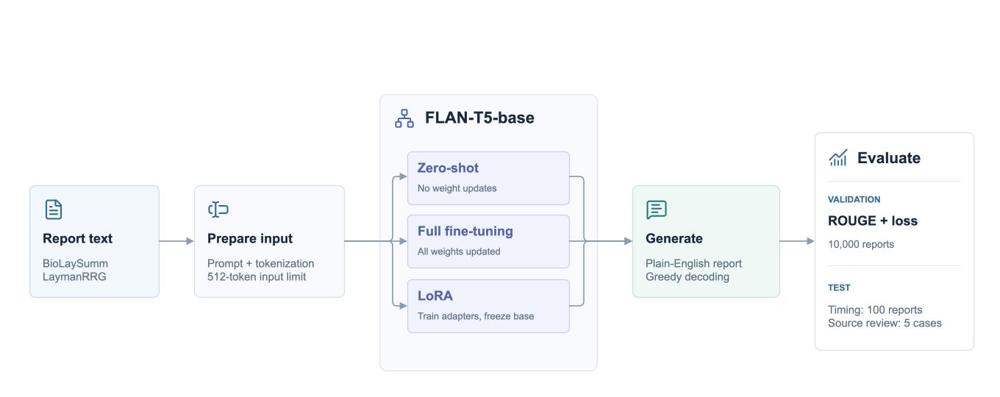

# FLAN-T5 for Layperson Radiology Report Generation

COMP3710 — Junrong Tang (s4983489) — Hard difficulty

## Problem and Approach

This project uses FLAN-T5 to rewrite radiology reports in plain English for patients. The aim is roughly a sixth-grade reading level without losing clinical findings, anatomical details, negation or uncertainty. I compare a zero-shot baseline with full fine-tuning and LoRA fine-tuning using ROUGE scores, resource measurements and a four-case review of generated reports. The model receives report text only, not medical images.

`google/flan-t5-base` is an instruction-tuned encoder-decoder transformer. The encoder processes the instruction and report using self-attention. The decoder generates the explanation using causal self-attention and cross-attention to the encoder output. Fine-tuning uses teacher forcing with token-level cross-entropy loss. The zero-shot baseline leaves the model unchanged. Full fine-tuning updates all weights, while LoRA freezes the base model and trains low-rank updates in the attention layers. The implementation uses PyTorch, Transformers, PEFT and Accelerate.

[Chung et al.](https://arxiv.org/abs/2210.11416) report better held-out benchmark performance after instruction tuning, although this does not directly measure performance on radiology reports. [Hu et al.](https://arxiv.org/abs/2106.09685) describe low-rank updates as `W = W₀ + (α/r)BA` and discuss limitations of small ranks. These updates can be merged into the base weights for inference, but the adapter in this project is kept separate.



## Dataset and Preprocessing

The official [BioLaySumm LaymanRRG dataset](https://huggingface.co/datasets/BioLaySumm/BioLaySumm2025-LaymanRRG-opensource-track) is used without re-splitting or augmentation:

| Split | Reports | Use |
| --- | ---: | --- |
| Training | 150,454 | Full and LoRA fine-tuning |
| Validation | 10,000 | ROUGE and validation loss; all references are non-empty |
| Test | 10,537 | Generation, timing and source-grounded error analysis |

The split sizes were checked after loading. Only the training split is used for parameter updates. ROUGE is computed on the official validation split, as required by the assessment. Test references are not public, so test reports are used for generation and comparison with the source text, not reference-based scoring.

`radiology_report` is the input and `layman_report` the target. Source and image identifiers are retained for auditing, but images are not loaded. Each report follows this prompt and a newline:

```text
Explain this radiology report in plain English for a patient. Preserve the findings, negation, and uncertainty:
```

Inputs and targets are tokenized separately and truncated to 512 tokens each, including special tokens and, for inputs, the prompt. Dynamic batch padding uses attention masks for inputs and `-100` for target padding, which is ignored by the loss. References never enter source inputs, and complete original references are retained for ROUGE.

## Feasibility Review

**User need and scope.** Technical radiology language can be difficult for patients to understand. The prototype aims to explain findings clearly while preserving the original qualifications. It does not interpret images or make new diagnoses.

**Model choice and course concepts.** I selected FLAN-T5-base for text-to-text generation and compare its zero-shot outputs with full fine-tuning and rank-8 LoRA on BioLaySumm LaymanRRG. This Hard-difficulty design uses encoder-decoder attention, transfer learning and supervised sequence prediction to investigate whether better ROUGE scores also mean more faithful explanations.

**Five testable acceptance criteria.**

1. Keep training and validation separate, exclude reference answers from model inputs, and evaluate all methods on identical validation examples.
2. Improve ROUGE-1, ROUGE-2, ROUGE-L and ROUGE-Lsum over the zero-shot baseline.
3. Preserve findings, negation, uncertainty and examination limitations without unsupported claims or important omissions in a four-case audit.
4. Explain medical terms clearly without unexplained jargon or repeated wording in the audited outputs.
5. Complete each formal job within 12 hours on one 40 GB A100 and save weights that can be reloaded for inference.

**Initial feasibility evidence.** Data checks confirmed split sizes and the availability of validation references. Small CPU tests checked tokenization, padding masks, finite loss values and LoRA adapter gradients while the base weights remained frozen. A save-and-reload test produced matching predictions.

**Budget, risks and fallback.** The budget was one A100 GPU with a 12-hour limit per job. The main risks were slow validation, 512-token truncation and clinically inaccurate summaries. I planned to save a checkpoint after each epoch and reduce the number of epochs for both fine-tuning methods if runtime became a problem. The validation set would remain unchanged. A source-based review was needed because ROUGE cannot detect every factual error.

**Experimental plan.** Train both adapted models for two epochs with seed 42, compare them against the zero-shot baseline using the same prompt and decoding method, profile compute use, and inspect four test reports for clinical errors.

## Experimental Design

All methods used the same checkpoint, prompt, validation reports and greedy decoding. Formal runs used one NVIDIA A100-PCIE-40GB and two CPU cores on Rangpur, with a 12-hour limit per job. Both adaptations used the complete training split:

| Setting | Full fine-tuning | LoRA fine-tuning |
| --- | --- | --- |
| Starting checkpoint | `google/flan-t5-base` | Same |
| Epochs / optimizer updates | 2 / 18,808 | 2 / 18,808 |
| Batch / gradient accumulation | 2 / 8 (effective batch 16) | Same |
| Optimizer / learning rate | AdamW / `5e-5` | AdamW / `3e-4` |
| Schedule / warm-up / weight decay | Linear decay / 0 / 0 | Same |
| Precision | FP32; no mixed precision | Same |
| Input / target limits | 512 / 512 tokens | Same |
| Seed | 42 | Same |
| Generation | Greedy; at most 512 new tokens | Same |
| Model selection | Final epoch | Final epoch |
| Adaptation | All weights | `q`, `v`; rank 8, alpha 16, dropout 0.05 |

LoRA fine-tuning used no trainable biases. No hyperparameter search was conducted. Both adapted models were evaluated after each epoch, and the final epoch was used for comparison. The learning rates differ, so this comparison does not isolate the effect of adaptation method alone. Saved identifiers and references were checked to confirm that all methods used the same validation examples.

The full fine-tuning and LoRA fine-tuning jobs completed in **8:11:11** and **9:45:45**, respectively, including setup, validation, saving and test inference. Both saved models were reloaded successfully.

## Results

### Validation Quality

Scores are mean per-example ROUGE F1 on a **0–100 scale**, with Porter stemming and NLTK sentence splitting for ROUGE-Lsum, evaluated on all 10,000 validation reports.

| Condition | ROUGE-1 | ROUGE-2 | ROUGE-L | ROUGE-Lsum | Validation loss |
| --- | ---: | ---: | ---: | ---: | ---: |
| Zero-shot baseline | 12.19 | 4.13 | 10.84 | 11.32 | 2.4202 |
| Full fine-tuning, 2 epochs | **74.47** | **56.83** | **69.71** | **71.63** | **0.5123** |
| LoRA fine-tuning, 2 epochs | 71.25 | 52.10 | 65.97 | 68.19 | 0.7206 |


*Scores come from saved validation outputs. Each method was evaluated in one run.*

Both adapted models scored much higher than the baseline. Full fine-tuning exceeded LoRA fine-tuning by **3.74 ROUGE-L points**. From epoch one to two, validation loss decreased from **0.5449 to 0.5123** for full fine-tuning and from **0.7630 to 0.7206** for LoRA fine-tuning. ROUGE-L increased from **69.11 to 69.71** and **65.14 to 65.97**, respectively.

### Resource Use and Inference

| Condition | Total parameters | Trainable parameters | Peak allocated VRAM (MiB) | Measured train/eval routine (s) |
| --- | ---: | ---: | ---: | ---: |
| Baseline | 247,577,856 | 0 | 1,428.48 | 3,256.38 (validation only) |
| Full | 247,577,856 | 247,577,856 | 8,692.12 | 29,265.91 |
| LoRA fine-tuning | 248,462,592 | 884,736 | 5,353.66 | 34,980.96 |

For both fine-tuning methods, `train_runtime` includes both validation passes and epoch checkpoint saving, but excludes final export and test inference. Baseline time covers validation alone. VRAM is peak PyTorch allocated memory, not total process memory. The saved field `peak_gpu_memory_mb` is expressed here in **MiB**, since the code divides bytes by `1024²`.

LoRA fine-tuning updated **0.356%** of its parameters and used **38.4%** less peak allocated VRAM than full fine-tuning, but its recorded training routine took longer. Both methods still run the base model and generate complete sequences during validation. Adapter overhead is one possible cause, but it was not measured separately.

Inference used the same **100 test reports sampled with seed 42**, batch size one, on the same GPU model:

| Condition | Generated tokens | Generation time (s) | Mean seconds/report | Tokens/second | Inference peak allocated VRAM (MiB) |
| --- | ---: | ---: | ---: | ---: | ---: |
| Baseline | 3,794 | 61.52 | 0.615 | 61.67 | 1,043.04 |
| Full | 6,916 | 107.99 | 1.080 | **64.04** | 1,043.04 |
| LoRA fine-tuning | 6,827 | 139.51 | 1.395 | 48.94 | 1,046.41 |

Timing includes only CUDA-synchronized `generate()` calls. It excludes loading, tokenization, input transfer, decoding and scoring. There was no warm-up. Token counts exclude decoder start and padding tokens but include EOS. The baseline generated shorter outputs, so seconds per report cannot be compared without considering output length. Timing was measured once per method.

## Clinical Safety Autopsy: Four Test Cases

I inspected the first 30 predictions from the 100-report test sample and selected four cases to examine different errors. Cases 1–4 correspond to reports 14, 15, 19 and 20 in the seed-42 sample. I compared each output with its source report because test references are not publicly available.

The source reports and model outputs below are reproduced unchanged. All four inputs and their generated outputs were below the 512-token limits, so truncation does not explain the errors discussed here.

### Case 1: Repetition, omission and anatomical location

Source: **PadChest**. Identifier: `216840111366964013590140476722013044085724775_02-062-040.png`.

**Original report:**

> Images of the lingular and right basal zones are consistent with bronchiectasis and COPD. A small nodular image of small size is noted in the left parahilar region. There is an increase in apical pleural thickening on the left. A complete study with a chest CT is recommended.

**Baseline:**

> A complete chest CT is recommended.

**Full fine-tuning:**

> The images of the left lower lung and the lower right lung are consistent with a condition called bronchiectasis and chronic obstructive pulmonary disease (COPD). There is a small round spot in the left lung area near the hilum. The thickening of the lung coverings at the top on the left side is more noticeable. It is suggested to do a full chest CT scan for further evaluation.

**LoRA fine-tuning:**

> The images of the lingular and right basal areas are consistent with bronchiectasis and COPD. A small nodule of small size is seen in the left parahilar region. There is an increase in thickening of the pleural pleural pleural pleural thickening on the left. It is recommended to have a full study with a chest CT scan.

**Analysis.** The baseline keeps the CT recommendation but omits bronchiectasis, COPD, the small nodule and pleural thickening. LoRA retains more findings, but repeats “pleural” four times and drops the “apical” location of the thickening. Full fine-tuning avoids the repetition and explains pleural thickening in simpler language. However, it describes the lingular region as “the left lower lung,” even though the lingula is part of the left upper lobe. This makes the location less anatomically accurate. The two adapted outputs have different weaknesses despite covering more of the report than the baseline.

### Case 2: Unsupported fluid findings and omissions

Source: **BIMCV-COVID19**. Identifier: `ses-E67984`.

**Original report:**

> Posteroanterior chest radiograph. Impression: Right basal and lingular consolidation, consider an inflammatory or infectious origin. Chronic parenchymal lung changes. Right apical thickening. Radiologic signs of EPO (extrapleural opacity). Skin fold projected over the right hemithorax.

**Baseline:**

> A chest radiograph.

**Full fine-tuning:**

> A chest x-ray taken from the back to the front shows a solid area in the lower right part of the lung and a part called the lingular, which could be due to inflammation or infection. There are also long-term changes in the lung tissue. The top part of the right lung is thicker than normal. There are signs of fluid buildup outside the lung. A skin fold is seen over the right side of the chest.

**LoRA fine-tuning:**

> The chest x-ray taken from the front shows signs of fluid buildup in the lower right part of the lung and a thickening of the lung tissue at the top. There are also signs of fluid buildup in the outer parts of the lungs. A skin fold is seen over the right side of the chest.

**Analysis.** The baseline gives almost no clinical information beyond the type of examination. The source defines EPO as “extrapleural opacity,” but full fine-tuning changes it to “fluid buildup outside the lung.” LoRA also introduces fluid in both the lower right lung and the outer lung region, although no fluid is reported. It does not retain the chronic parenchymal changes or the possible inflammatory or infectious origin of the consolidation. These are unsupported additions and omissions, not just differences in wording.

### Case 3: Negation, uncertainty and diagnostic meaning

Source: **BIMCV-COVID19**. Identifier: `ses-E46467`.

**Original report:**

> No clear pulmonary infiltrates are observed, with a questionable right basal opacity that should be evaluated over time.

**Baseline:**

> This report is a radiology report for a patient with a pulmonary infiltrate.

**Full fine-tuning:**

> There are no obvious signs of lung infections, but there might be a possible cloudiness at the bottom right part of the lung that needs to be checked over time.

**LoRA fine-tuning:**

> There are no clear signs of lung infections, but there might be a possible cloudiness at the bottom right part of the lung that should be checked over time.

**Analysis.** The source reports no clear pulmonary infiltrates, but separately notes a questionable right basal opacity requiring follow-up. The baseline turns the qualified negative into an affirmative statement and omits both the uncertainty and follow-up. Both fine-tuned outputs preserve the negative wording, uncertain opacity and recommendation for later assessment. However, they replace the imaging term “pulmonary infiltrates” with “lung infections.” An infiltrate is not necessarily an infection, so this introduces a more specific clinical interpretation than the source supports. The phrase “might be a possible” is also needlessly repetitive.

### Case 4: Incorrect medical explanation and examination scope

Source: **BIMCV-COVID19**. Identifier: `ses-E28411`.

**Original report:**

> Findings: 22-year-old woman with acute appendicitis. Positive PCR for coronavirus. Requested examination performed. Suboptimal study as both lung apices are not included. In the visualized lung parenchyma, no consolidations or other intraparenchymal pulmonary infiltrates are observed. No pleural effusion is evident. Cardiac silhouette and pulmonary hila are of normal morphology and size.

**Baseline:**

> A 22-year-old woman with acute appendicitis. Positive PCR for coronavirus.

**Full fine-tuning:**

> A 22-year-old woman has acute appendicitis, which is a type of apex infection. She tested positive for coronavirus, and was asked to have an examination done. The scan didn't show the top parts of both lungs, which is a bit of a problem. The lung tissue that can be seen in the image doesn't show any signs of pneumonia or other lung infections. There's no fluid around the lungs. The heart and the areas where the lungs connect to the heart look normal in shape and size.

**LoRA fine-tuning:**

> The patient is a 22-year-old woman who has a severe appendicitis. She has a positive PCR test for coronavirus. She wanted to have an examination done. The examination was not very good because both the top parts of the lungs are not included. The lungs look clear without any signs of pneumonia or other lung infections. There is no fluid around the lungs. The heart and the areas where the lungs connect to the heart are normal in shape and size.

**Analysis.** The baseline omits the lung findings and the fact that both lung apices were excluded. Full fine-tuning retains that examination limit, but incorrectly defines appendicitis as “a type of apex infection.” Appendicitis is inflammation of the appendix, not an infection of the lung apex. LoRA changes “acute appendicitis” to “severe appendicitis,” adding a severity judgment absent from the source. It also turns “requested examination performed” into a statement about what the patient wanted. Although LoRA notes that the apices were not imaged, it later says “The lungs look clear” without limiting that conclusion to the visible tissue. Full fine-tuning makes the imaging limit clearer, but its incorrect explanation of appendicitis is a serious factual error.

### What the Cases Show

Fine-tuning improves coverage compared with the zero-shot baseline, but the longer, more fluent summaries introduce their own errors. The audited outputs contain unsupported fluid or infection interpretations, inaccurate anatomical wording and changes to severity or examination scope. Some of these errors occur in the full fine-tuned model even though it has the highest validation ROUGE scores.

ROUGE measures textual overlap rather than clinical correctness. These four cases were selected from the first 30 sampled predictions to examine different failure modes, not to estimate their prevalence. Without a representative safety evaluation, the cases cannot establish which fine-tuning method is clinically safer.

## Recommendation and Limitations

Full fine-tuning achieved the highest validation ROUGE scores and the higher measured generation throughput of the two adapted models (**64.04** versus **48.94 tokens/second**). LoRA used **38.4%** less peak allocated training VRAM and saved a **3.56 MB** adapter instead of **990.35 MB** of full-model weights (decimal MB). The adapter still needs the base model for inference. These results favour full fine-tuning for quality-focused follow-up experiments and LoRA when training memory and storage are tighter. They do not demonstrate a clinical safety advantage for either model.

The feasibility criteria can now be checked against the completed experiments:

| Criterion | Outcome | Evidence                                                                                                                                      |
| --- | --- |-----------------------------------------------------------------------------------------------------------------------------------------------|
| 1. Data and evaluation separation | Met for the official record-level splits | Training uses the training split, and all three methods use the same validation reports. Patient-level overlap was not independently checked. |
| 2. Higher ROUGE than zero-shot | Met | Both adapted models improve all four reported ROUGE metrics.                                                                                  |
| 3. Clinical faithfulness in four cases | Not met | Both adapted methods introduce unsupported clinical interpretations, and some important details are omitted or changed.                       |
| 4. Clear, non-repetitive explanations | Not met | The LoRA fine-tuning output in Case 1 repeats “pleural,” and some terms remain inaccurate or unclear. Reading grade was not measured.         |
| 5. Resource budget and saved models | Met | Both formal training jobs completed within 12 hours on one A100, and the saved models were reloaded.                                          |

**Engineering recommendation.** Neither model should generate summaries for patients without review. A safer workflow would compare each draft with its source report before release, checking anatomical location, findings, negation, uncertainty and severity. It should also flag missing findings, follow-up advice and examination limits, as well as repeated or unexplained technical terms. A summary with a possible clinical contradiction or omission should be sent to a qualified reviewer. These checks are proposed safeguards, not features implemented or validated in this prototype.

**Limitations.** The experiments used one checkpoint, one seed and one prompt. Full fine-tuning and LoRA used different learning rates, with no hyperparameter or rank search. Inference timings were measured once without warm-up. Longer reports may be affected by the 512-token input limit, although the four audited examples were not truncated.

The selected cases were not independently assessed by a clinician and do not give an error rate. I did not measure reading grade, patient comprehension or clinical outcomes. Patient-level independence between official dataset splits and possible pretraining contamination were not verified. A representative test sample with clinician-labelled factual errors and a measured readability score would be needed before judging clinical reliability or testing a confidence-based review rule.

## Implementation and Reproduction

| File | Purpose |
| --- | --- |
| `dataset.py` | Load official splits and tokenize source/target pairs |
| `modules.py` | Load FLAN-T5, configure LoRA fine-tuning and count parameters |
| `train.py` | Evaluate/train models and save predictions, metrics, weights and curves |
| `predict.py` | Reload a run, generate explanations and measure inference |

### Environment

Formal runs used the following environment on Rangpur:

| Component | Recorded version |
| --- | --- |
| Python | 3.11.15 |
| PyTorch / CUDA build | 2.13.0 / 13.0 |
| NVIDIA driver / GPU | 590.48.01 / A100-PCIE-40GB |
| Transformers / PEFT | 4.57.6 / 0.19.1 |
| Datasets / Accelerate | 5.0.0 / 1.14.0 |
| SentencePiece / rouge-score | 0.2.2 / 0.1.2 |
| NLTK | 3.10.0; `punkt_tab` installed |
| NumPy / Matplotlib | 2.4.6 / 3.11.1 |

To install the direct dependencies into an environment with compatible Python and PyTorch:

```bash
python -m pip install transformers==4.57.6 peft==0.19.1 \
    datasets==5.0.0 accelerate==1.14.0 sentencepiece==0.2.2 \
    rouge-score==0.1.2 nltk==3.10.0 numpy==2.4.6 matplotlib==3.11.1
python -m nltk.downloader punkt_tab
```

### Training and Prediction

Run these commands from the **repository root**, using new output directories. Formal experiments require an allocated CUDA GPU; the default prediction device is CPU.

```bash
python recognition/FLAN_T5_s4983489/train.py \
    --mode baseline --output-dir ../runs/baseline

python recognition/FLAN_T5_s4983489/train.py \
    --mode full --output-dir ../runs/full --epochs 2 --learning-rate 0.00005

python recognition/FLAN_T5_s4983489/train.py \
    --mode lora --output-dir ../runs/lora --epochs 2 --learning-rate 0.0003

python recognition/FLAN_T5_s4983489/predict.py \
    --run-dir ../runs/full \
    --text "No clear pulmonary infiltrates are observed, with a questionable right basal opacity that should be evaluated over time."

python recognition/FLAN_T5_s4983489/predict.py \
    --run-dir ../runs/full --split test --samples 100 --device cuda \
    --output ../runs/full/inference-test100.json
```

Training defaults match the experiment table and use complete official splits. Each run saves its configuration, metrics and validation predictions. Fine-tuning also saves `model/`, the latest epoch checkpoint, `trainer_state.json` and `training_curves.png` with loss and four ROUGE curves. Checkpoints are written after epoch validation; the CLI does not expose resume support.

Prediction requires the run configuration and, for adapted models, its saved `model/`. The custom input above corresponds to Case 3. Use `--split validation` to generate and score validation reports. Test and custom text have no reference-based ROUGE. Sampling uses the saved seed. `--output` needs a new file in an existing directory. Without it, the result is printed. `--help` lists the remaining options.

### Experiment Records

Records are kept outside Git. Local paths below are relative to the repository root; remote paths are in my Rangpur account.

| Records | Location |
| --- | --- |
| Local baseline results | `../runs/rangpur-20261003/` |
| Local fine-tuning results | `../runs/rangpur-20261004-epochs2/` |
| Remote baseline and original logs | `/home/Student/s4983489/comp3710-ass2/runs/20261003-formal/` |
| Remote fine-tuned weights and checkpoints | `/home/Student/s4983489/comp3710-ass2/runs/20261004-epochs2/{full,lora}/` |

Trained weights and checkpoints are stored on Rangpur and are not included in this repository.

## Artificial Intelligence Usage Disclosure

I used OpenAI Codex to assist with literature review, debugging and experiment execution. I wrote the initial implementation and used ChatGPT to review and edit the wording and clinical error discussion in this README. The implementation was checked with small CPU tests for tokenization, padding masks, adapter gradients and model save/reload behaviour. Experimental scores were taken from saved validation outputs, and the reported clinical examples were compared with their source reports. I am responsible for checking the final code, measurements and conclusions.

## References

1. COMP3710 assessment specification.
2. Chung et al. (2022), [*Scaling Instruction-Finetuned Language Models*](https://arxiv.org/abs/2210.11416), Section 5 and Appendices A.1 and G.2.
3. Hu et al. (2021), [*LoRA: Low-Rank Adaptation of Large Language Models*](https://arxiv.org/abs/2106.09685), Sections 4.1 and 7.
4. [BioLaySumm LaymanRRG dataset](https://huggingface.co/datasets/BioLaySumm/BioLaySumm2025-LaymanRRG-opensource-track) and [FLAN-T5-base model card](https://huggingface.co/google/flan-t5-base).
5. Hugging Face documentation: [Datasets loading](https://huggingface.co/docs/datasets/loading), [summarisation](https://huggingface.co/docs/transformers/tasks/summarization), [Trainer](https://huggingface.co/docs/transformers/main_classes/trainer), [generation](https://huggingface.co/docs/transformers/main_classes/text_generation), [PEFT](https://huggingface.co/docs/peft/main/en/quicktour) and [checkpoint format](https://huggingface.co/docs/peft/developer_guides/checkpoint).
6. Google Research, [ROUGE implementation](https://github.com/google-research/google-research/tree/master/rouge).
