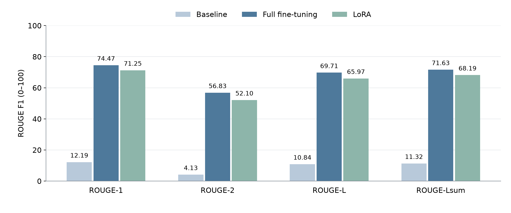

# FLAN-T5 for Layperson Radiology Report Generation

COMP3710 / COMP7710 — s4983489 — Hard difficulty

## Problem and Approach

This project turns technical radiology reports into plain-English explanations for patients, aiming for a sixth-grade reading level while preserving findings, anatomy, negation and uncertainty. It compares zero-shot FLAN-T5 with full fine-tuning and LoRA. The central question is whether adaptation produces more faithful, readable explanations, as well as better ROUGE scores. The model receives text reports only; it does not interpret images.

`google/flan-t5-base` is an instruction-tuned encoder-decoder transformer. Its encoder represents the instruction and report through self-attention; the decoder uses causal self-attention and cross-attention to generate an explanation. Training uses teacher-forced token-level cross-entropy. The project therefore applies attention, transfer learning and supervised sequence prediction. The baseline has no parameter updates, full fine-tuning updates all weights, and LoRA learns low-rank attention updates while freezing the base model. The implementation uses PyTorch through Transformers, PEFT and Accelerate.

[Chung et al.](https://arxiv.org/abs/2210.11416) show that instruction tuning improves FLAN-T5's held-out benchmark performance, but leave single-task fine-tuning untested and call for application-specific assessment. This supports testing the model on radiology reports without assuming medical accuracy. [Hu et al.](https://arxiv.org/abs/2106.09685) define LoRA updates as `W = W₀ + (α/r)BA` and note that small ranks may not suit every task. Their inference-latency benefit relies on merging the update into the base weights; the adapter here remains separate.

## Dataset and Preprocessing

The official [BioLaySumm LaymanRRG dataset](https://huggingface.co/datasets/BioLaySumm/BioLaySumm2025-LaymanRRG-opensource-track) is used without re-splitting or augmentation:

| Split | Reports | Use |
| --- | ---: | --- |
| Training | 150,454 | Full and LoRA fine-tuning |
| Validation | 10,000 | ROUGE and validation loss; all references are non-empty |
| Test | 10,537 | Generation, timing and source-grounded error analysis |

These counts were checked in the loaded data. Training uses only the official training split. The assessment specifies validation for quantitative comparison. Test reference explanations are not public, so test ROUGE cannot be calculated. Patient-level independence of the published splits was not established.

`radiology_report` is the input and `layman_report` the target. Source and image identifiers are retained for auditing, but images are not loaded. Each report follows this prompt and a newline:

```text
Explain this radiology report in plain English for a patient. Preserve the findings, negation, and uncertainty:
```

Inputs and targets are tokenized separately and truncated to 512 tokens each, including special tokens and, for inputs, the prompt. Dynamic batch padding uses attention masks for inputs and `-100` for target padding, which is ignored by the loss. References never enter source inputs, and complete original references are retained for ROUGE.

## Feasibility Review

This section records the study design and initial feasibility evidence.

**User need and scope.** Patients need plain-English explanations of radiology reports that preserve findings, negation and uncertainty. This project translates existing text rather than interpreting images or making diagnoses. Its central question is whether fine-tuning improves understandable, faithful explanations, rather than merely increasing word overlap with references.

**Model choice and course concepts.** The Hard-difficulty project uses `google/flan-t5-base`, an instruction-tuned encoder-decoder transformer. It applies attention, transfer learning and supervised sequence prediction. Full fine-tuning updates all weights; LoRA learns rank-8 attention updates while freezing the base model. The official BioLaySumm LaymanRRG splits contain 150,454 training, 10,000 validation and 10,537 test reports. They are used directly. The test split is available, but its reference explanations are not public, so reference-based evaluation uses validation only.

**Five testable acceptance criteria.**

1. Keep training and validation separate, exclude reference answers from source inputs, and evaluate all methods on identical validation examples.
2. Improve ROUGE-1, ROUGE-2, ROUGE-L and ROUGE-Lsum over the zero-shot baseline.
3. Preserve findings, negation, uncertainty and examination limitations without unsupported claims or important omissions in a five-case audit.
4. Explain technical terms clearly and avoid unexplained jargon or repetition in the audited outputs.
5. Complete each formal job within 12 hours on one 40 GB A100 and save weights that can be reloaded for inference.

**Initial feasibility evidence.** Data checks confirmed the official split counts and availability of validation references. Small CPU checks verified tokenization, padding masks, finite losses, adapter gradients with frozen base weights, and matching predictions after saving and reloading. These checks support implementation feasibility; they do not establish clinical quality.

**Budget, risks and fallback.** The compute allocation is one A100 and at most 12 hours per job. Risks include slow generation-based validation, input truncation, unsupported medical explanations and omissions. Epoch checkpoints preserve completed work. If the time budget is insufficient, reduce the epoch budget equally for both fine-tuning methods while retaining the same validation set. ROUGE alone cannot establish clinical safety; qualitative source checks are necessary.

**Experimental plan.** Compare the unchanged baseline, full fine-tuning and LoRA using the same prompt and generation settings. Use two epochs and seed 42 for both adaptations, report quality and resource measurements, and inspect five test cases.

## Experimental Design

All methods used the same checkpoint, prompt, validation reports and greedy decoding. Formal runs used one NVIDIA A100-PCIE-40GB and two CPU cores on Rangpur, with a 12-hour limit per job. Both adaptations used the complete training split:

| Setting | Full fine-tuning | LoRA |
| --- | --- | --- |
| Starting checkpoint | `google/flan-t5-base` | Same |
| Epochs / optimizer updates | 2 / 18,808 | 2 / 18,808 |
| Batch / gradient accumulation | 2 / 8; effective batch 16 | Same |
| Optimizer / learning rate | AdamW / `5e-5` | AdamW / `3e-4` |
| Schedule / warm-up / weight decay | Linear decay / 0 / 0 | Same |
| Precision | FP32; no mixed precision | Same |
| Input / target limits | 512 / 512 tokens | Same |
| Seed | 42 | Same |
| Generation | Greedy; at most 512 new tokens | Same |
| Model selection | Final epoch | Final epoch |
| Adaptation | All weights | `q`, `v`; rank 8, alpha 16, dropout 0.05 |

LoRA used no trainable biases. There was no hyperparameter search; both models were evaluated after each epoch and retained the final epoch. The different learning rates mean the comparison concerns these configurations, rather than isolating the effect of low-rank adaptation. Saved identifiers and references confirm that evaluation examples match across methods.

An initial three-epoch full run timed out during final validation after **12:00:18**, leaving no saved weights. Both adaptations were restarted from the base model for two epochs with epoch checkpoints; the completed baseline was reused. The final full and LoRA jobs finished in **8:11:11** and **9:45:45**, including setup, validation, saving and test inference. Their weights were successfully reloaded. The failed run is additional compute cost and is excluded from the completed-run table below.

## Results

### Validation Quality

Scores are mean per-example ROUGE F1 on a **0–100 scale**, with Porter stemming and NLTK sentence splitting for ROUGE-Lsum, evaluated on all 10,000 validation reports.

| Condition | ROUGE-1 | ROUGE-2 | ROUGE-L | ROUGE-Lsum | Validation loss |
| --- | ---: | ---: | ---: | ---: | ---: |
| Zero-shot baseline | 12.19 | 4.13 | 10.84 | 11.32 | 2.4202 |
| Full fine-tuning, 2 epochs | **74.47** | **56.83** | **69.71** | **71.63** | **0.5123** |
| LoRA, 2 epochs | 71.25 | 52.10 | 65.97 | 68.19 | 0.7206 |



*Validation scores from the saved results. Both adaptations trained for two epochs; the baseline had no parameter updates. Each method has one run, with no estimated confidence interval.*

Both adaptations improved reference overlap substantially. Full fine-tuning exceeded LoRA by **3.74 ROUGE-L points**. Between epochs one and two, validation loss fell from **0.5449 to 0.5123** for full and **0.7630 to 0.7206** for LoRA; ROUGE-L rose from **69.11 to 69.71** and **65.14 to 65.97**, respectively. These two observations show continued improvement, but do not establish convergence.

### Resource Use and Inference

| Condition | Total parameters | Trainable parameters | Peak allocated VRAM (MiB) | Measured train/eval routine (s) |
| --- | ---: | ---: | ---: | ---: |
| Baseline | 247,577,856 | 0 | 1,428.48 | 3,256.38 (validation only) |
| Full | 247,577,856 | 247,577,856 | 8,692.12 | 29,265.91 |
| LoRA | 248,462,592 | 884,736 | 5,353.66 | 34,980.96 |

For full and LoRA, `train_runtime` includes both validation passes and epoch checkpoint saving, but excludes final export and test inference. Baseline time covers validation alone. VRAM is peak PyTorch allocated memory, not total process memory. The saved field `peak_gpu_memory_mb` is expressed here in **MiB**, since the code divides bytes by `1024²`.

LoRA trained **0.356%** of its parameters and reduced peak allocated VRAM by **38.4%**, yet took longer. The backbone still processes the text and validation generates full sequences. The separate adapter may also add overhead, although these contributions were not profiled.

Inference used the same **100 test reports sampled with seed 42**, batch size one, on the same GPU model:

| Condition | Generated tokens | Generation time (s) | Mean seconds/report | Tokens/second | Inference peak allocated VRAM (MiB) |
| --- | ---: | ---: | ---: | ---: | ---: |
| Baseline | 3,794 | 61.52 | 0.615 | 61.67 | 1,043.04 |
| Full | 6,916 | 107.99 | 1.080 | **64.04** | 1,043.04 |
| LoRA | 6,827 | 139.51 | 1.395 | 48.94 | 1,046.41 |

Timing covers CUDA-synchronized `generate()` calls only, excluding loading, tokenization, input transfer, decoding and scoring. There was no warm-up. Token counts exclude decoder start/padding and include EOS. The baseline's lower latency accompanies shorter outputs, so it does not show faster generation at equivalent coverage. Timing was measured once per method.

## Clinical Safety Autopsy: Five Test Cases

Cases were selected after inspecting the first 30 of the 100 test predictions to illustrate hallucinations, omissions and readability problems. Numbers are one-based positions in the seed-42 sample, not original dataset indices. The audit compares outputs with source reports; no test references or case-level ROUGE are available. It is AI-assisted and has not been independently assessed by a clinician.

Complete sources and outputs are reproduced below. Input lengths were 57–131 tokens and generated lengths 6–123, below the 512-token limits, so truncation does not explain these failures. The proposed triggers are interpretations of the text, not causes established experimentally.

### Case 14: Repetition, technical language, and lost location detail

Source: **PadChest**. Identifier: `216840111366964013590140476722013044085724775_02-062-040.png`.

**Original report:**

> Images of the lingular and right basal zones are consistent with bronchiectasis and COPD. A small nodular image of small size is noted in the left parahilar region. There is an increase in apical pleural thickening on the left. A complete study with a chest CT is recommended.

**Baseline:**

> A complete chest CT is recommended.

**Full fine-tuning:**

> The images of the left lower lung and the lower right lung are consistent with a condition called bronchiectasis and chronic obstructive pulmonary disease (COPD). There is a small round spot in the left lung area near the hilum. The thickening of the lung coverings at the top on the left side is more noticeable. It is suggested to do a full chest CT scan for further evaluation.

**LoRA:**

> The images of the lingular and right basal areas are consistent with bronchiectasis and COPD. A small nodule of small size is seen in the left parahilar region. There is an increase in thickening of the pleural pleural pleural pleural thickening on the left. It is recommended to have a full study with a chest CT scan.

**Analysis.** The baseline retains only the CT recommendation, omitting every finding. Full fine-tuning preserves most content but changes the lingular location to the less specific “left lower lung”; it does not explicitly name a different lobe. Bronchiectasis and hilum remain unexplained. LoRA repeats “pleural” four times, drops the apical location and retains substantial jargon. Its “nodule” wording is also more definite than the source's description of an image.

**Likely trigger and risk.** The dense list of findings and unfamiliar anatomical terms exposes weaknesses in coverage and simplification. Lost locations and unreadable repetition could prevent a patient from understanding which findings prompted the CT recommendation.

### Case 15: Unsupported fluid interpretation and loss of differential findings

Source: **BIMCV-COVID19**. Identifier: `ses-E67984`.

**Original report:**

> Posteroanterior chest radiograph. Impression: Right basal and lingular consolidation, consider an inflammatory or infectious origin. Chronic parenchymal lung changes. Right apical thickening. Radiologic signs of EPO (extrapleural opacity). Skin fold projected over the right hemithorax.

**Baseline:**

> A chest radiograph.

**Full fine-tuning:**

> A chest x-ray taken from the back to the front shows a solid area in the lower right part of the lung and a part called the lingular, which could be due to inflammation or infection. There are also long-term changes in the lung tissue. The top part of the right lung is thicker than normal. There are signs of fluid buildup outside the lung. A skin fold is seen over the right side of the chest.

**LoRA:**

> The chest x-ray taken from the front shows signs of fluid buildup in the lower right part of the lung and a thickening of the lung tissue at the top. There are also signs of fluid buildup in the outer parts of the lungs. A skin fold is seen over the right side of the chest.

**Analysis.** The baseline omits all findings. Full preserves the main findings and possible inflammatory/infectious origin, but turns the explicitly defined extrapleural opacity into unsupported “fluid buildup.” LoRA adds fluid claims, omits the lingular and chronic changes and the differential explanation, and loses right-sided apical detail. Full leaves “lingular” unexplained; LoRA reads fluently despite changing the content.

**Likely trigger and risk.** Both adapted models replace imaging terminology with a familiar fluid-based explanation that the report does not support. This could give a patient a false account of the findings; the text alone does not establish whether fluid was actually present.

### Case 18: Fabricated symptom narrative despite preserved final negation

Source: **PadChest**. Identifier: `216840111366964012373310883942009104090852549_00-071-085.png`.

**Original report:**

> Reason for consultation: dyspnea, wheezing, and abundant expectoration. Posteroanterior and lateral chest radiograph. No parenchymal consolidation is visualized.

**Baseline:**

> a reconstructed pulmonary edema

**Full fine-tuning:**

> The patient came in because they were having trouble breathing, wheezing, and a lot of coughing up. We took a chest x-ray from the front and the side. There's no sign of lung tissue becoming solid or dense.

**LoRA:**

> The patient came in because they were having trouble breathing, coughing, and were looking for a good night. The chest x-ray was taken from the front and the side. There is no sign of lung tissue becoming solidified.

**Analysis.** The baseline invents pulmonary edema and omits the symptoms and negative consolidation finding. Full preserves most content, though “a lot of coughing up” leaves the symptom explanation incomplete. LoRA invents “looking for a good night” and substitutes nonspecific coughing for wheezing and abundant expectoration. It still preserves the absence of consolidation.

**Likely trigger and risk.** Paraphrasing the symptom list appears to introduce unrelated language and lose detail. Preserving the final negation does not compensate for a fabricated symptom narrative or diagnosis. The source provides no edema diagnosis, and its negative consolidation finding alone does not settle that question.

### Case 19: Loss of negation and uncertainty in the baseline

Source: **BIMCV-COVID19**. Identifier: `ses-E46467`.

**Original report:**

> No clear pulmonary infiltrates are observed, with a questionable right basal opacity that should be evaluated over time.

**Baseline:**

> This report is a radiology report for a patient with a pulmonary infiltrate.

**Full fine-tuning:**

> There are no obvious signs of lung infections, but there might be a possible cloudiness at the bottom right part of the lung that needs to be checked over time.

**LoRA:**

> There are no clear signs of lung infections, but there might be a possible cloudiness at the bottom right part of the lung that should be checked over time.

**Analysis.** The baseline loses “no clear,” asserts a pulmonary infiltrate and omits the uncertain right basal opacity and follow-up. Both adapted models preserve location, uncertainty and follow-up in readable language, but replace the imaging term “infiltrates” with the narrower “lung infections.” Their “might be a possible” wording is redundant.

**Likely trigger and risk.** The sentence combines qualified negation with an uncertain positive observation. Collapsing these distinctions overstates the evidence, while substituting an infection-specific meaning can mislead the reader about what the image establishes. The original report is equivocal, not unequivocally normal.

### Case 20: Invented explanation and lost examination scope

Source: **BIMCV-COVID19**. Identifier: `ses-E28411`.

**Original report:**

> Findings: 22-year-old woman with acute appendicitis. Positive PCR for coronavirus. Requested examination performed. Suboptimal study as both lung apices are not included. In the visualized lung parenchyma, no consolidations or other intraparenchymal pulmonary infiltrates are observed. No pleural effusion is evident. Cardiac silhouette and pulmonary hila are of normal morphology and size.

**Baseline:**

> A 22-year-old woman with acute appendicitis. Positive PCR for coronavirus.

**Full fine-tuning:**

> A 22-year-old woman has acute appendicitis, which is a type of apex infection. She tested positive for coronavirus, and was asked to have an examination done. The scan didn't show the top parts of both lungs, which is a bit of a problem. The lung tissue that can be seen in the image doesn't show any signs of pneumonia or other lung infections. There's no fluid around the lungs. The heart and the areas where the lungs connect to the heart look normal in shape and size.

**LoRA:**

> The patient is a 22-year-old woman who has a severe appendicitis. She has a positive PCR test for coronavirus. She wanted to have an examination done. The examination was not very good because both the top parts of the lungs are not included. The lungs look clear without any signs of pneumonia or other lung infections. There is no fluid around the lungs. The heart and the areas where the lungs connect to the heart are normal in shape and size.

**Analysis.** The baseline retains only the clinical background and omits the imaging result. Full invents the definition “appendicitis … a type of apex infection,” but correctly limits the negative lung findings to visible tissue. LoRA changes “acute” to “severe,” attributes the examination request to the patient and says “the lungs look clear” without limiting that statement to visible tissue, despite mentioning the missing apices earlier. Both adaptations narrow consolidation/infiltrates to infection; LoRA also leaves PCR unexplained.

**Likely trigger and risk.** Adjacent diagnostic and anatomical terms may encourage a false explanation, while simplification weakens the examination's scope. The result could overstate disease severity or reassure a patient about regions that were not imaged.

### What the Cases Show

Omissions recur across the baseline outputs, while unsupported explanatory substitutions recur in cases 15, 19 and 20. These suggest weaknesses in coverage and terminology simplification. Repetition in case 14 and the fabricated phrase in case 18 are individual observations; this purposive sample cannot establish error prevalence or rank the methods by safety.

Token-level training rewards reference prediction without explicitly checking each claim against the source. That offers a plausible explanation for fluent but inaccurate substitutions. ROUGE can miss short changes in negation, severity or examination scope when surrounding words overlap. The higher validation scores therefore support better reference overlap, while the test cases show that factual errors remain.

## Recommendation and Limitations

Full fine-tuning performed best in this comparison, with higher ROUGE and faster measured generation within the A100 budget. LoRA reduced adaptation memory use and produced a **3.56 MB** adapter, compared with **990.35 MB** of full model weights (decimal MB), although the adapter still needs the base model.

The completed runs met the data-separation, ROUGE and resource criteria. The five-case audit did not meet the faithfulness and readability criteria, so these results do not support unsupervised patient-facing use. Before deployment, the observed errors would require:

- Source checks for findings, location, negation and uncertainty, including unsupported additions and severity changes.
- Coverage checks for important findings, follow-up recommendations and examination limitations.
- Verified plain-language definitions, repetition checks and clinician review before release.

These safeguards are proposals, not implemented features. Any confidence filter would need calibration against clinician-labelled factual errors. The study used one seed, one checkpoint/prompt and different learning rates, without rank or hyperparameter searches. Reading grade, patient comprehension and clinical outcomes were not measured. Truncation may affect longer reports, and pretraining contamination was not assessed. A larger representative sample with clinician-rated factuality and readability would be needed to evaluate clinical suitability.

## Implementation and Reproduction

| File | Purpose |
| --- | --- |
| `dataset.py` | Load official splits and tokenize source/target pairs |
| `modules.py` | Load FLAN-T5, attach LoRA and count parameters |
| `train.py` | Evaluate/train models and save predictions, metrics, weights and curves |
| `predict.py` | Reload a run, generate explanations and measure inference |

### Environment

Formal runs used the following environment on Rangpur:

| Component | Recorded version |
| --- | --- |
| Python | 3.11.15 |
| PyTorch / CUDA build | 2.13.0 / 13.0 |
| NVIDIA driver / GPU | 590.48.01 / A100-PCIE-40GB |
| Transformers / PEFT | 4.57.6 / 0.19.1 |
| Datasets / Accelerate | 5.0.0 / 1.14.0 |
| SentencePiece / rouge-score | 0.2.2 / 0.1.2 |
| NLTK | 3.10.0; `punkt_tab` installed |
| NumPy / Matplotlib | 2.4.6 / 3.11.1 |

The separate local `ICLR3.0` environment used Python 3.12.13, PyTorch 2.12.1, NumPy 2.5.1 and Matplotlib 3.11.2, with the same other listed package versions, for CPU checks. To install the direct dependencies into an environment with compatible Python and PyTorch:

```bash
python -m pip install transformers==4.57.6 peft==0.19.1 \
    datasets==5.0.0 accelerate==1.14.0 sentencepiece==0.2.2 \
    rouge-score==0.1.2 nltk==3.10.0 numpy==2.4.6 matplotlib==3.11.1
python -m nltk.downloader punkt_tab
```

### Training and Prediction

Run these commands from the **repository root**, using new output directories. Formal experiments require an allocated CUDA GPU; the default prediction device is CPU.

```bash
python recognition/FLAN_T5_s4983489/train.py \
    --mode baseline --output-dir ../runs/baseline

python recognition/FLAN_T5_s4983489/train.py \
    --mode full --output-dir ../runs/full --epochs 2 --learning-rate 0.00005

python recognition/FLAN_T5_s4983489/train.py \
    --mode lora --output-dir ../runs/lora --epochs 2 --learning-rate 0.0003

python recognition/FLAN_T5_s4983489/predict.py \
    --run-dir ../runs/full \
    --text "No clear pulmonary infiltrates are observed, with a questionable right basal opacity that should be evaluated over time."

python recognition/FLAN_T5_s4983489/predict.py \
    --run-dir ../runs/full --split test --samples 100 --device cuda \
    --output ../runs/full/inference-test100.json
```

Training defaults match the experiment table and use complete official splits. Each run saves its configuration, metrics and validation predictions. Fine-tuning also saves `model/`, the latest epoch checkpoint, `trainer_state.json` and `training_curves.png` with loss and four ROUGE curves. Checkpoints are written after epoch validation; the CLI does not expose resume support.

Prediction requires the run configuration and, for adapted models, its saved `model/`. The custom input above corresponds to case 19. Use `--split validation` to generate and score validation reports; test/custom text has no ROUGE. Sampling uses the saved seed. `--output` needs a new file in an existing directory; omitting it prints the result. `--help` lists the remaining options.

### Recorded Inputs and Artifacts

| Input | Recorded revision |
| --- | --- |
| `google/flan-t5-base` | `7bcac572ce56db69c1ea7c8af255c5d7c9672fc2` |
| BioLaySumm LaymanRRG dataset | `6783ab38f9de28c4372799346f51d3927ae7eb9a` |

Formal jobs used the verified cache at `/home/Student/s4983489/comp3710-ass2/hf-cache` with `HF_HUB_OFFLINE=1` and two OpenMP/MKL threads. The commands above load by name; exact snapshot reproduction needs the recorded cache/revisions. Seed 42 alone does not guarantee identical results across environments. Single-GPU execution was tested; distributed execution was not.

Records are kept outside Git. Local paths below are relative to the repository root; remote paths are in my Rangpur account.

| Records | Location |
| --- | --- |
| Local baseline results | `../runs/rangpur-20261003/` |
| Local full/LoRA results | `../runs/rangpur-20261004-epochs2/` |
| Remote baseline and original logs | `/home/Student/s4983489/comp3710-ass2/runs/20261003-formal/` |
| Remote full/LoRA weights and checkpoints | `/home/Student/s4983489/comp3710-ass2/runs/20261004-epochs2/{full,lora}/` |

Local copies contain metrics, configurations, complete validation predictions, 100 test outputs per method and training histories/curves where applicable. Launch records retain the source snapshot, SHA-256 manifest, environment and `requirements-freeze.txt`. Trained weights and optimizer checkpoints remain on Rangpur and are absent from a fresh clone. Datasets, caches and model weights are excluded from Git.

## Artificial Intelligence Usage Disclosure

I used OpenAI Codex to help with literature review, coding and debugging, running experiments, analysing results, and preparing the figure.

Verification included checking data separation, tokenization, losses and LoRA gradients, and confirming that predictions and ROUGE scores matched before and after reloading saved models. Results and case quotations were checked against saved experiment outputs. These checks also used AI assistance. I remain responsible for reviewing and understanding the submitted work.

## References

1. COMP3710 / COMP7710 assessment specification, Sections 2.6, 3, 5.3 and 6.1, with subsequent instructor clarifications.
2. Chung et al. (2022), [*Scaling Instruction-Finetuned Language Models*](https://arxiv.org/abs/2210.11416), Section 5 and Appendices A.1 and G.2.
3. Hu et al. (2021), [*LoRA: Low-Rank Adaptation of Large Language Models*](https://arxiv.org/abs/2106.09685), Sections 4.1 and 7.
4. [BioLaySumm LaymanRRG dataset](https://huggingface.co/datasets/BioLaySumm/BioLaySumm2025-LaymanRRG-opensource-track) and [FLAN-T5-base model card](https://huggingface.co/google/flan-t5-base).
5. Hugging Face documentation: [Datasets loading](https://huggingface.co/docs/datasets/loading), [summarisation](https://huggingface.co/docs/transformers/tasks/summarization), [Trainer](https://huggingface.co/docs/transformers/main_classes/trainer), [generation](https://huggingface.co/docs/transformers/main_classes/text_generation), [PEFT](https://huggingface.co/docs/peft/main/en/quicktour) and [checkpoint format](https://huggingface.co/docs/peft/developer_guides/checkpoint).
6. Google Research, [ROUGE implementation](https://github.com/google-research/google-research/tree/master/rouge).
